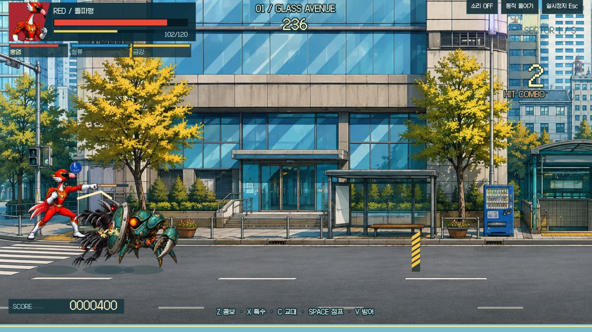
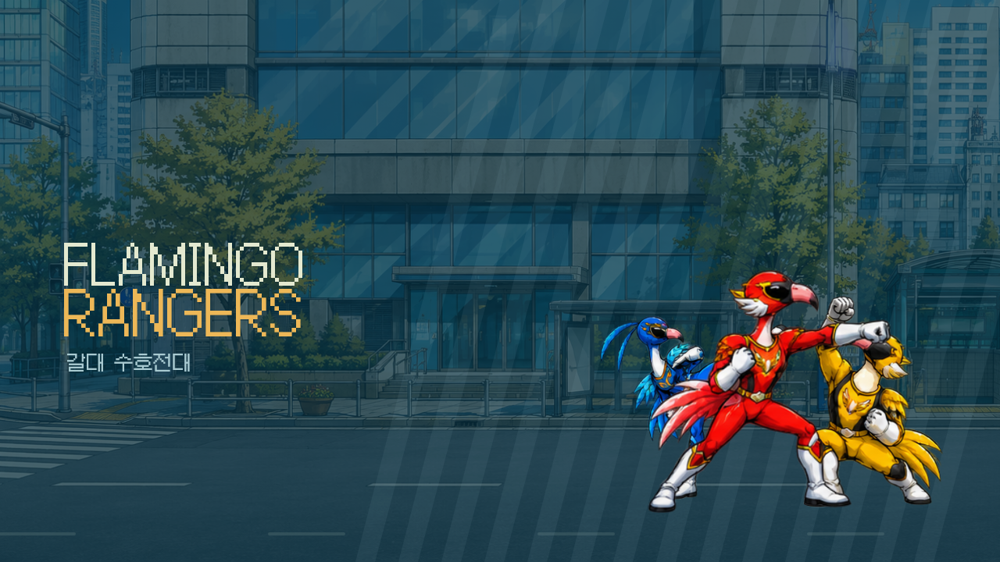
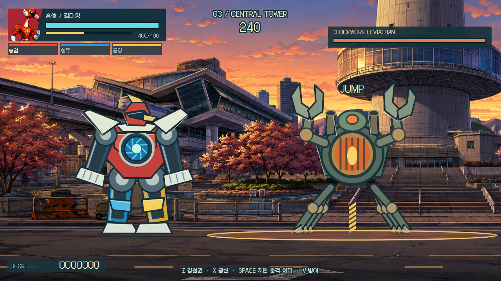

# 갈대 수호전대

**Flamingo Rangers — 세 대원을 교대하며 도시를 되찾는 독립 2D 액션 게임.**



[게임 소스](src/) · [실제 플레이 검증](docs/browser-qa.md) · [원화 제작 기록](docs/art-direction.md)

빨강 **홍염**의 상승권, 파랑 **청류**의 질풍각, 노랑 **금강**의 진동권. 공격 예고를 읽고 방패를 깨고, 쓰러진 보스에게 세 대원이 함께 결정타를 날립니다. 마지막 구역에서는 서로 다른 세 기계 모듈이 **갈대왕**으로 합체합니다.

<table>
<tr>
<td width="50%"><a href="docs/art-direction.md"></a><br /><b>24개의 대원 포즈</b><br />대기 · 달리기 · 주먹 · 상승권 · 발차기 · 점프 · 방어</td>
<td width="50%"><a href="docs/verification.md"></a><br /><b>거대 로봇 최종전</b><br />별도 관절 구조 · 강철권 · 광선 · 지면 충격 회피</td>
</tr>
</table>

> 맨 위 이미지는 실제 브라우저 플레이입니다. 표의 제목/메카 이미지는 게임 렌더러의 결정적 CPU 캡처이며 실제 브라우저 완주 증거가 아닙니다. [검증 범위](docs/verification.md)

## 실행

Node.js 22.12 이상이 필요합니다. 사이트 배포나 계정, API 키는 필요하지 않습니다.

```sh
npm ci
npm run dev
```

로컬 개발 주소: `http://127.0.0.1:4203/` — 포트가 이미 사용 중이면 다른 포트로 임의 변경하지 않고 종료합니다.

```sh
npm test
npm run build
```

## 조작

| 입력                     | 동작                             |
| ------------------------ | -------------------------------- |
| ← / → 또는 A / D         | 이동                             |
| Z → Z → Z                | 주먹 · 연속 주먹 · 마무리 발차기 |
| Space 또는 W             | 점프                             |
| 공중 Z                   | 공중 발차기                      |
| X                        | 대원별 특수기, 기력 소모         |
| ↑ + X                    | 상승권, 방패 파괴와 띄우기       |
| C                        | 살아 있는 다음 대원으로 교대     |
| V 또는 ↓                 | 전방 방어                        |
| 쓰러진 보스 앞에서 C · C | 협동 결정타                      |
| Esc                      | 일시정지 / 계속                  |

터치 버튼도 제공하며 좁은 화면에서는 가로 방향이 유리합니다. 소리는 기본 OFF이고 버튼을 눌렀을 때만 합성 효과음을 사용합니다. 외부 음원을 재생하거나 다운로드하지 않습니다.

## 세 구역

| 구역        | 전투                                            | 읽어야 할 신호                  |
| ----------- | ----------------------------------------------- | ------------------------------- |
| 유리빛 대로 | 3개 차단 구역 + 드릴 비틀                       | 긴 전진 드릴 공격 전의 웅크림   |
| 운하 교차로 | 3개 차단 구역 + 글라스 맨티스                   | 공중 도약과 긴 회복 동작        |
| 중앙 관제탑 | 3개 차단 구역 + 갈대왕 합체 + 클록워크 레비아탄 | 바닥 전체 충격 직전의 양팔 들기 |

대원마다 체력이 따로 유지됩니다. 방패 병정은 정면 기본 공격 피해를 줄이지만 상승권·진동권·공중 공격에는 약합니다. 다음 구역에 들어갈 때 일부 체력이 회복되고 쓰러진 대원도 다시 합류합니다. 게임 저장·계정·랭킹 서버는 없습니다.

## 코드와 원화

- `src/engine.mjs`: DOM 없는 60 Hz 전투 시뮬레이션, 공격의 준비/유효/회복 시간, 태그·보스·합체 상태.
- `src/renderer.mjs`: 2D 스프라이트, UI, 별도 관절식 기계, 상태에 맞는 타격 효과.
- `src/atlas.mjs`: 균일하지 않은 원화 칸에서 연결된 RGBA 전경을 한 번 분리하여 옆 포즈가 끼지 않게 그리는 로더. 소스 PNG는 그대로 보존합니다.
- `public/art`: 이번 게임을 위해 생성한 2개 스프라이트 아틀라스와 구역별 배경 3개. [원화 출처와 프롬프트](docs/art-direction.md)
- `public/fonts`: OFL 라이선스의 Galmuri11. [글꼴 라이선스](public/fonts/OFL.md)

## 패러디의 범위

참고작은 국내에서 ‘후레쉬맨’으로 알려진 **無個性戦隊○○レンジャー**입니다. `Power Rangers: Red Hot Rescue`와는 다른 게임입니다. 원작의 세 대원 교체, 가로 도시 전투, 협동 결정타와 거대 로봇전이라는 문법을 참고했습니다. 원작의 캐릭터·로고·SWF·스프라이트·음악을 가져오지 않았고 원작 7개 스테이지의 동일 복원이라고 주장하지 않습니다. 이 게임은 새 홍학 대원과 괴인, 3개 구역, 새 수치와 전투 규칙을 쓰는 비공식 패러디입니다.

<p><a href="https://github.com/minwoo19930301/flamingo-arcade-2"><b>← 플라밍고 게임 기록 모음</b></a> · <a href="https://github.com/minwoo19930301/mario-2-5d"><b>Super Mario 2.5D →</b></a></p>
